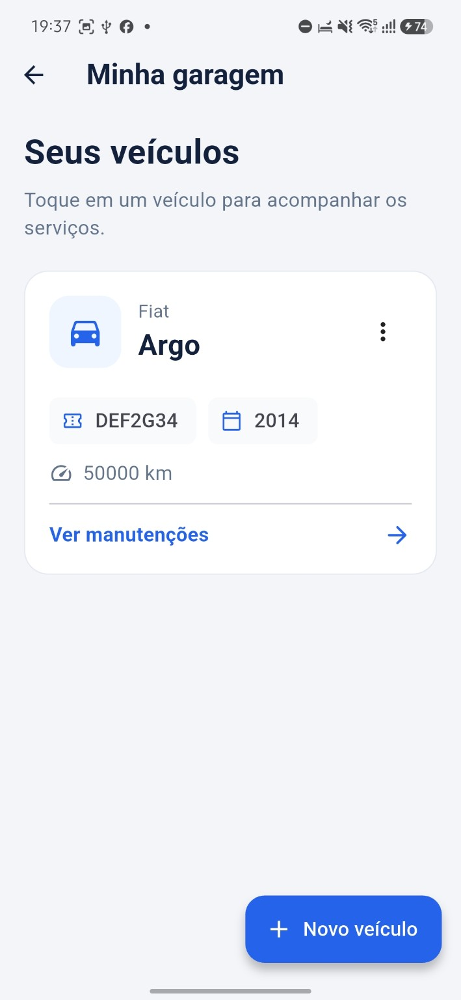

# AutoBoost

**Sua garagem. Tudo sob controle.**

Aplicativo acadêmico para organizar veículos, serviços de manutenção e gastos. Desenvolvido em **Flutter e Dart**, com **SQLite local**, para a atividade de desenvolvimento mobile.

## Funcionalidades

- Resumo com quantidade de veículos, serviços registrados e total gasto.
- Cadastro, consulta, edição e exclusão de veículos.
- Histórico de manutenção separado por veículo.
- Cadastro, edição e exclusão de serviços, com atualização do total.
- Validação de placa, ano, quilometragem e valor.
- Confirmação antes de excluir; a exclusão de um veículo também remove seus serviços.
- Persistência local: os dados permanecem após fechar e reabrir o app.
- Operação offline após a instalação.

## Tecnologias e escopo

| Item | Uso |
| --- | --- |
| Flutter / Dart | Interface, navegação e regras de validação |
| Material 3 | Componentes visuais |
| `sqflite` | Acesso ao SQLite |
| `path` | Caminho do arquivo `autoboost.db` |

**Plataforma validada: Android**, em um Samsung Galaxy A26 com Android 16. Os diretórios de outras plataformas são os gerados pelo Flutter; esta versão não configura SQLite para navegador ou Windows. Não há servidor, conta de usuário, sincronização em nuvem ou IA nesta entrega.

## Como executar

Pré-requisitos: Flutter estável compatível com o projeto, Android SDK, ferramentas de linha de comando do SDK, Git e um celular Android autorizado para depuração USB ou um emulador configurado.

O `pubspec.yaml` exige **Dart `^3.13.2`**. O ambiente usado na apresentação reportou Flutter 3.47.2. Consulte as restrições do projeto antes de trocar a versão do SDK.

Na pasta em que estão `pubspec.yaml` e `lib/`, execute:

```powershell
flutter pub get
flutter doctor
flutter analyze
flutter devices
flutter run -d ID_DO_DISPOSITIVO
```

Substitua `ID_DO_DISPOSITIVO` pelo identificador retornado por `flutter devices`. Downloads de dependências e a primeira compilação precisam de internet; o aplicativo instalado usa apenas o banco local.

## Gerar o APK

```powershell
flutter build apk --release
```

Saída: `build/app/outputs/flutter-apk/app-release.apk`.

O APK foi gerado e instalado no aparelho de apresentação. A configuração Android atual assina a compilação release com a chave de debug: adequada ao protótipo acadêmico, mas não preparada para publicação na Play Store. O APK não inclui os cadastros do celular de quem o gerou.

**Preservação dos dados:** desinstalar o app ou limpar seus dados remove o banco. No teste realizado, `flutter install` desinstalou a versão anterior; não use esse fluxo para uma atualização que precise preservar os cadastros. Para uma atualização compatível, manter identificador e assinatura é necessário.

## Estrutura principal

| Arquivo | Responsabilidade |
| --- | --- |
| `lib/main.dart` | Tema, início, garagem e cadastro/edição de veículos |
| `lib/manutencoes_page.dart` | Histórico, cadastro/edição/exclusão de serviços e formatação |
| `lib/banco_dados.dart` | Abertura do banco, tabelas e chaves estrangeiras |
| `pubspec.yaml` / `pubspec.lock` | Dependências e versões resolvidas |
| `docs/DOCUMENTACAO.md` | Requisitos, telas, banco e limitações |
| `docs/TESTES.md` | Evidências e roteiro de validação manual |
| `docs/GITHUB.md` | Publicação do repositório passo a passo |
| `docs/APRESENTACAO.md` | Demonstração para o professor |

## Capturas do aplicativo





## Telas

Início → Minha garagem → Histórico de serviços. Formulários próprios permitem cadastrar ou editar veículos e manutenções. São cinco telas principais; os formulários são reutilizados na edição.

## Validação

O usuário executou `flutter analyze` sem problemas, gerou o APK e confirmou cadastro, edição, exclusão, soma dos gastos e persistência offline. O teste padrão do contador foi retirado porque não correspondia ao AutoBoost. **Não há suíte de testes automatizados nesta versão.** As alterações de comentários deste pacote não foram compiladas novamente nesta sessão; confira com `flutter analyze` no notebook.

## Autoria e licença

Responsável pelo desenvolvimento nesta entrega: **Adrian Carvalho Garcia**. Acrescente os demais integrantes e informações da disciplina, se aplicável. Não foi escolhida uma licença de código aberto; publicar o repositório não substitui essa escolha.

## Documentação oficial

- [Instalação do Flutter](https://docs.flutter.dev/install)
- [Desenvolvimento Android com Flutter](https://docs.flutter.dev/platform-integration/android/setup)
- [Compilação Android](https://docs.flutter.dev/deployment/android)
- [Pacote sqflite](https://pub.dev/packages/sqflite)
- [Enviar projeto local ao GitHub](https://docs.github.com/en/migrations/importing-source-code/using-the-command-line-to-import-source-code/adding-locally-hosted-code-to-github)
